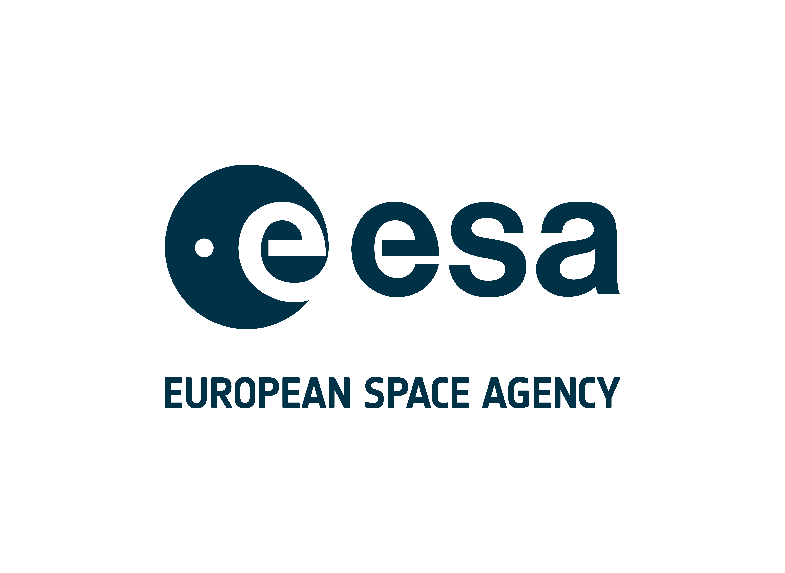
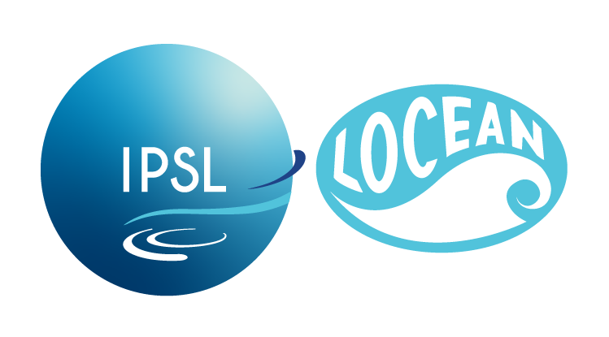
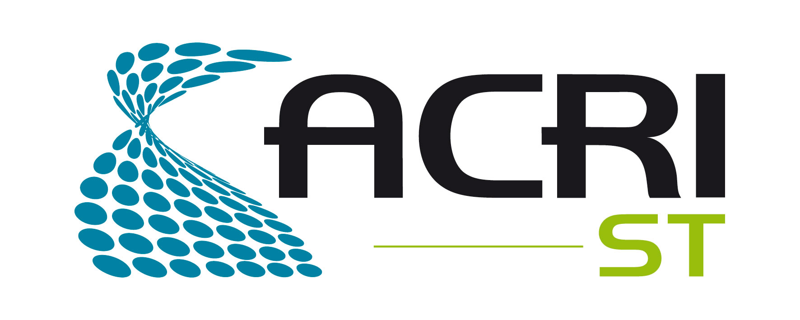

::: {.hero-map}
::: {.hero-text}
## Watching ENSO Through Sea Surface Salinity

### A satellite salinity view of the developing 2026 El Niño

The displacement of the western Pacific fresh-pool edge provides an independent SSS-based view of El Niño/La Niña evolution.
:::
:::

::: {.cci-heritage}

Built on the scientific and data heritage of ESA CCI+ Sea Surface Salinity (CCI+SSS).
:::

::: {.status-box}
**Status of this page**  
This page is a scientific demonstrator. It shows how satellite sea surface salinity (SSS) can help monitor El Niño–Southern Oscillation (ENSO) from an independent ocean-salinity perspective.
:::

::: {.latest-box}
**Latest situation**  
The SSS-based indicator shows that the eastern edge of the western equatorial Pacific fresh pool continued its rapid eastward displacement through September 2026. It is now about 10° of longitude — roughly 1,000 km — farther east than at the peak of the strong 2015–2016 El Niño.

The timing is particularly notable: this extent has been reached by September, several months earlier than the usual late-year seasonal maximum of El Niño conditions. This marks an unusually early and rapid eastward displacement of the fresh-pool boundary.

This comparison should nevertheless be interpreted with appropriate caution.

::: {.latest-meta}
**Latest SSS data:**  
**Page update:** 
:::
:::

# Dashboard: recent evolution

The dashboard below focuses on the most recent three years, ending with the latest available SSS field. The upper panel shows sea surface salinity in the tropical Pacific, with the 34.8-pss isohaline marking the eastern edge of the western equatorial fresh pool. The red circle/ellipse highlights the tracked fresh-pool edge between 2°S and 2°N. The lower panel shows the synchronized evolution of the SSS-based ENSO indicator.

<video class="dashboard-video" controls preload="none" poster="assets/figures/latest/dashboard_sss_enso_poster_latest.png?v=">
  <source src="assets/animations/dashboard_sss_enso_latest.mp4?v=" type="video/mp4">
  Your browser does not support the video tag.

</video>

## How does the current event compare with previous El Niños?

The curves below track the same 34.8-pss fresh-pool boundary (S34.8), aligned on a common event-relative seasonal cycle to compare the timing, speed and maximum observed eastward extent of its displacement.

{fig-alt="Longitude of the S34.8 fresh-pool boundary across four El Niño events, with a shared seasonal cycle progressing upward and partial records for 2009–10 and 2026."}

# Key message

During El Niño development, the western Pacific fresh pool tends to expand eastward. Satellite sea surface salinity observations allow this displacement to be monitored month by month. The longitude of the 34.8-pss isohaline provides a simple way to track this movement and compare it with reference ENSO indicators.

# Retrospective view: 2010 to present

The animation below provides the full retrospective view since the beginning of the salinity-satellite period used here. It combines three synchronized diagnostics:

- the map animation of sea surface salinity and the tracked 34.8-pss isohaline;
- the Hovmöller diagram showing the longitude-time evolution of equatorial SSS;
- the SSS-based ENSO indicator evolving through time.

This combined view shows how the current evolution compares with previous El Niño and La Niña episodes.

<video class="highlight-video" controls preload="none" poster="assets/figures/latest/combined_sss_enso_poster_latest.png?v=">
  <source src="assets/animations/combined_sss_enso_latest.mp4?v=" type="video/mp4">
  Your browser does not support the video tag.
</video>

# Comparison with established ENSO indicators

The salinity-based indicator is compared below with widely used ENSO indicators. The agreement between them supports the interpretation that the displacement of the salinity front captures the ENSO signal from an independent salinity perspective. Differences are also informative, because sea surface salinity reflects freshwater fluxes, ocean transport, and coupled ocean-atmosphere processes in a way that differs from indices based on sea surface temperature (SST) or multivariate ENSO indices.

## MEI.v2

MEI.v2 is the dedicated NOAA PSL multivariate ENSO product combining oceanic and atmospheric information. It represents overlapping two-month seasons, identified by their ending month. The latest value is September 2026, corresponding to August–September 2026. The Pearson correlation with S34.8 is 0.850 (n = 200).

{fig-alt="Comparison between the SSS-based ENSO indicator and NOAA PSL MEI.v2, through August–September 2026."}

## HadISST Niño-3.4

This NOAA PSL HadISST Niño-3.4 index measures SST anomalies in the central-eastern equatorial Pacific relative to 1981–2010. The latest observation is July 2026. The Pearson correlation with S34.8 is 0.817 (n = 198).

{fig-alt="Comparison between the SSS-based ENSO indicator and NOAA PSL HadISST Niño-3.4 SST anomalies relative to 1981–2010, through July 2026."}

**Data availability note:** the HadISST Niño-3.4 comparison ends in July 2026. MEI.v2 extends through September 2026 (the August–September season), and monthly relative Niño-3.4 extends through September 2026. Dates identify the first day of the represented month or MEI.v2 ending month.

### C3S Niño-3.4

This comparison uses a Niño 3.4 SST index derived directly from the **Copernicus Climate Change Service (C3S) SST dataset**, using a fixed 1991–2020 climatology to compute the anomaly.

The C3S-derived index provides a complementary SST-based reference for the SSS-based S34.8 indicator. This comparison uses twice-monthly sampling on the 1st and 15th and extends through September 2026. The latest September SST estimate is provisional. The Pearson correlation with S34.8 is 0.835 (n = 400).

{fig-alt="Comparison between the SSS-based S34.8 indicator and C3S Niño-3.4 SST anomalies relative to 1991–2020, sampled on the 1st and 15th through September 2026; the latest September estimate is provisional."}

## Monthly relative Niño-3.4 (ERSSTv6, 1991–2020)

This NOAA CPC monthly relative Niño-3.4 product uses ERSSTv6 and a 1991–2020 reference period to account for the broader tropical warming background. These are individual monthly values, not a three-month running mean. The latest observation is September 2026. The Pearson correlation with S34.8 is 0.847 (n = 200).

{fig-alt="Comparison between the SSS-based ENSO indicator and NOAA CPC monthly relative Niño-3.4 (ERSSTv6, 1991–2020), using individual monthly values through September 2026."}

# Additional diagnostics

The static figures below provide complementary views of the same SSS-based indicator. They are useful for readers who want to inspect the full-period record without replaying the animations.

## Full-period SSS-based ENSO indicator

{fig-alt="Latest SSS-based ENSO indicator derived from the longitude of the 34.8 pss isohaline in the equatorial Pacific."}

## Full-period Hovmöller view

{fig-alt="Hovmöller diagram showing equatorial sea surface salinity as a function of longitude and time with the tracked 34.8 pss isohaline."}

# Interpretation and caveats

This SSS indicator is experimental. Like all climate indices, it depends on methodological choices and on the product version used. In particular, it is sensitive to the definition of the isohaline, the latitude band, the selected longitude domain, the treatment of uncertain satellite retrievals, the handling of near-real-time data, and the definition of thresholds.

It should be interpreted as a complementary observational indicator, not as an operational ENSO product. The analysis is work in progress.

# Related ESA story

A general-audience ESA web story presents the broader context of SMOS sea surface salinity observations during El Niño development. This demonstrator builds on the same scientific motivation, with additional diagnostics focused on the equatorial western Pacific fresh-pool edge.

[SMOS salinity could offer early indicator of El Niño](https://www.esa.int/Applications/Observing_the_Earth/FutureEO/SMOS/SMOS_salinity_could_offer_early_indicator_of_El_Nino)

# References

- Qu, T., & Yu, J.-Y. (2014). *ENSO indices from sea surface salinity observed by Aquarius and Argo*. Journal of Oceanography, 70, 367–375. DOI: 10.1007/s10872-014-0238-4.
- MEI.v2: NOAA Physical Sciences Laboratory, <https://psl.noaa.gov/enso/mei/data/meiv2.data>
- HadISST Niño-3.4 (1981–2010): NOAA Physical Sciences Laboratory, <https://psl.noaa.gov/data/timeseries/month/data/nino34.long.anom.data>
- Monthly relative Niño-3.4 (ERSSTv6, 1991–2020): NOAA Climate Prediction Center, <https://www.cpc.ncep.noaa.gov/data/indices/Rnino34.ascii.txt>
- C3S SST: *Combined sea surface and sea ice surface temperature data derived from satellite observations*, <https://cds.climate.copernicus.eu/datasets/satellite-ist-sst-global?tab=overview>
- CCI+SSS: ESA Climate Change Initiative Sea Surface Salinity project.
- C3S: Copernicus Climate Change Service.
- C3S seasonal forecasts, <https://climate.copernicus.eu/seasonal-forecasts>

# Credits

**Scientific lead:** Fabrice Bonjean — LOCEAN

**Scientific and technical contributors**

- Jacqueline Boutin — LOCEAN
- Roberto Sabia — ESA
- Frédéric Rouffi — ACRI-ST
- Sebastien Guimbard — OCEANOSCOPE
- Jean-Luc Vergely — ACRI-ST
- Laetitia Parc — ACRI-ST
- Nicolas Kolodziejczyk — LOPS
- Stéphane Tarot — IFREMER/CATDS

::: {.logo-row}

:::

::: {.c3s-logo-row}

:::
